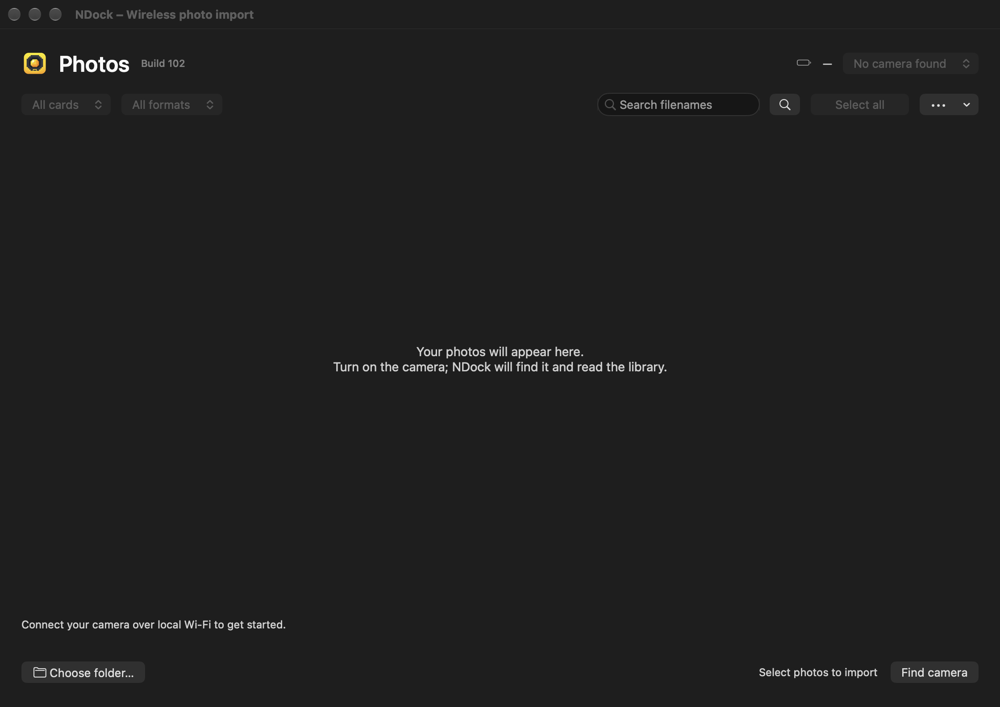
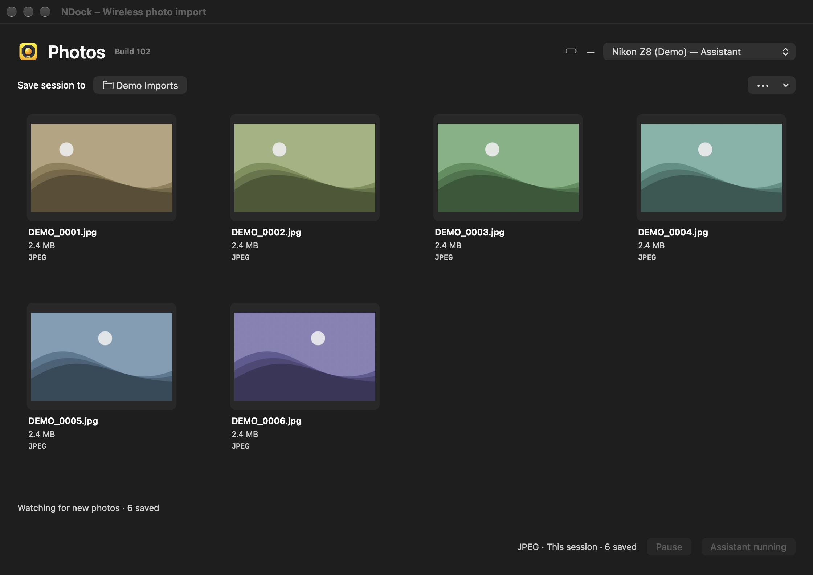

# NDock public beta

NDock is an independent macOS app for importing photos from a Nikon Z8 over local Wi-Fi. We are looking for Z8 owners to test installation, first pairing and a small JPEG/NEF import.

**Initial test setup:** Apple Silicon Mac, macOS 27.0 or later, Nikon Z8 firmware C 3.10, and a shared local network. Installation on a second Mac is a beta test goal. Other camera models and configurations are outside this first test.

- [Setup and first test](GETTING_STARTED.md) · [Known limits](KNOWN-ISSUES.md)
- **Beta in preparation.** There is no public installer yet.
- Interested in testing? Use **Issues → Volunteer for the beta**. Please include only your camera model, firmware and macOS version.

Pairing and transfers are local. NDock does not automatically upload diagnostics. Review any report before sharing. GitHub posts are public and are associated with your GitHub account.

NDock is not affiliated with or endorsed by Nikon.

## Screenshots

| Connect a camera | Assistant (experimental) |
|---|---|
|  |  |

Captured from the NDock interface using offline demo data. The illustrations are synthetic; no camera or personal photographs were used.

[Bundled component notices](THIRD_PARTY_NOTICES.md)

## Project and feedback

Publisher GitHub account: **artjomkutuzov-collab**. This repository is for downloads and feedback; the NDock development source is kept separately. Feedback is voluntary.
